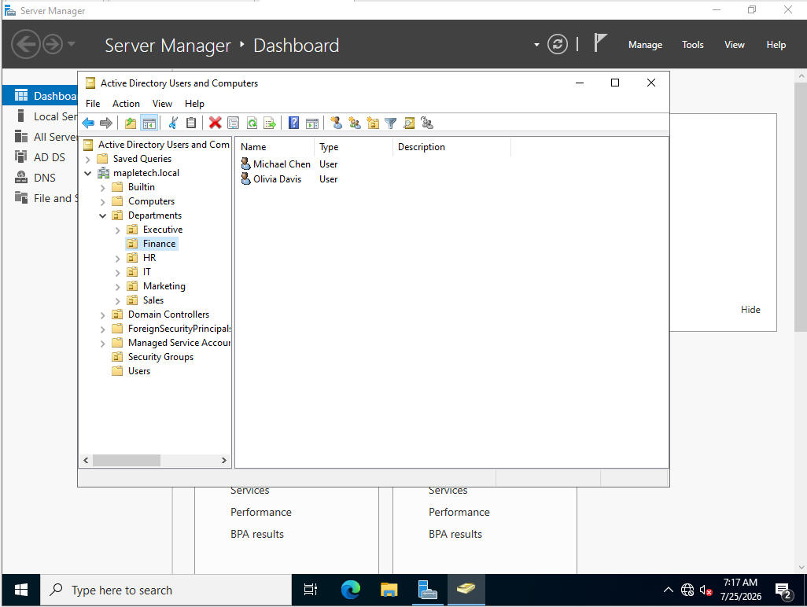

# Active Directory Home Lab

A hands-on Active Directory lab built using Windows Server 2022 and Windows 11 Pro in VMware Workstation Pro.

This project demonstrates the deployment and administration of a small Windows Active Directory environment, including user and group management, Organizational Units, DNS, domain joining, shared folders, NTFS permissions, and simulated Help Desk troubleshooting scenarios.

## Lab Environment

- Hypervisor: VMware Workstation Pro
- Domain Controller: Windows Server 2022 (DC01)
- Client: Windows 11 Pro (CLIENT01)
- Domain: mapletech.local
- Domain Controller IP: 192.168.3.10
- Client IPv4 Address: 192.168.3.129

## Repository Structure

The repository contains the Active Directory lab configuration, setup screenshots, and simulated Help Desk troubleshooting documentation.

- `screenshots/` — Screenshots showing the initial lab configuration, Active Directory structure, domain authentication, and folder permission tests.
- `Troubleshoot/` — Contains four simulated Help Desk ticket documents and a separate folder containing screenshots associated with the troubleshooting tickets.

## Project Objectives

The goal of this lab was to build a small Windows-based Active Directory environment and practice common IT administration and Help Desk troubleshooting tasks.

The lab objectives were to:

- Deploy Windows Server 2022 as a Domain Controller.
- Configure Active Directory Domain Services (AD DS) and DNS.
- Create the `mapletech.local` Active Directory domain.
- Organize users using Organizational Units (OUs).
- Create department-based security groups.
- Assign users to the appropriate security groups.
- Configure departmental shared folders.
- Apply NTFS permissions using security groups.
- Join a Windows 11 Pro workstation to the domain.
- Authenticate to the domain using an Active Directory user.
- Test and verify department-based file access.
- Troubleshoot simulated DNS resolution and client DNS configuration issues.
- Investigate and resolve domain user access and account lockout issues.
- Document Help Desk incidents, including investigation, resolution, verification, and screenshots.

## Active Directory Structure

The domain was organized using Organizational Units (OUs) for each department:

```text
mapletech.local
├── Departments
│   ├── Executive
│   ├── Finance
│   ├── HR
│   ├── IT
│   ├── Marketing
│   └── Sales
└── Security Groups
    ├── Executive_Group
    ├── Finance_Group
    ├── HR_Group
    ├── IT_Group
    ├── Marketing_Group
    └── Sales_Group
```

## Server and Active Directory Configuration

Windows Server 2022 was configured as the Domain Controller (DC01) for the `mapletech.local` domain.

The server was configured with a static IPv4 address of `192.168.3.10` and provided Active Directory Domain Services (AD DS) and DNS services for the lab environment.

### Domain Controller Configuration

- **Hostname:** `DC01`
- **Operating System:** Windows Server 2022 Standard Evaluation
- **Domain:** `mapletech.local`
- **IPv4 Address:** `192.168.3.10`
- **Role:** Domain Controller
- **Services:** Active Directory Domain Services (AD DS) and DNS


### Organizational Units

Departmental Organizational Units were created to logically organize users within Active Directory.

The following OUs were created:

- Executive
- Finance
- HR
- IT
- Marketing
- Sales


## Security Groups and User Management

Department-specific security groups were created to simplify permission management.

Users were assigned to their respective departmental security groups rather than receiving permissions individually.

For example, Finance users such as Michael Chen and Olivia Davis were organized within the Finance Organizational Unit.




## Shared Folders and NTFS Permissions

A shared folder structure was created on DC01 to separate departmental resources:

```text
C:\Shared
├── Executive
├── Finance
├── HR
├── IT
├── Marketing
└── Sales
```

NTFS permissions were configured so that each department's security group could access its corresponding folder.

For example, `Finance_Group` was granted **Modify** permissions to the Finance folder, while Administrators and SYSTEM retained Full Control.


## Windows 11 Client and Domain Authentication

A Windows 11 Pro workstation named `CLIENT01` was configured and joined to the `mapletech.local` Active Directory domain.

The client was configured with:

- **Computer Name:** `CLIENT01`
- **Domain:** `mapletech.local`
- **Operating System:** Windows 11 Pro
- **IPv4 Address:** `192.168.3.129`
- **DNS Server:** `192.168.3.10` (DC01)

The `whoami` command was used to verify that the user was logged in with a `mapletech.local` domain account.


## Permission Testing

The Active Directory configuration and NTFS permissions were tested using the Finance domain user `mchen`.

The tests confirmed that:

- The Finance user could access the Finance shared folder.
- The Finance user could create a file within the Finance folder.
- The Finance user was denied access to the Sales folder.

### Successful Access


### Denied Access


## Help Desk Troubleshooting Tickets

This section documents simulated Help Desk incidents completed in the Active Directory lab. Each ticket describes the reported problem, investigation steps, root cause, resolution, and verification.

### Ticket #1 — DNS Resolution Failure

Practiced troubleshooting a domain name resolution issue by comparing IP connectivity with DNS name resolution and investigating the client DNS configuration.

**Ticket documentation:** [View Ticket #1](troubleshooting/ticket-01-dns-failure.md)

### Ticket #2 — Finance Folder Access Issue

Investigated a shared-folder access problem by checking the user's department, security group membership, and NTFS permissions. Restored the required group membership and verified access.

**Ticket documentation:** [View Ticket #2](troubleshooting/ticket-02-file-permission.md)

### Ticket #3 — Domain Account Lockout

Configured and tested a domain account lockout policy, verified the lockout behaviour after repeated incorrect password attempts, and checked account recovery.

**Ticket documentation:** [View Ticket #3](troubleshooting/ticket-03-account-lockout.md)

### Ticket #4 — DNS Name Resolution Issue

Simulated an incorrect DNS server configuration on the Windows 11 client, tested the resulting lookup failure, restored the correct DNS server, and verified successful name resolution.

**Ticket documentation:** [View Ticket #4](troubleshooting/ticket-04-domain-name-resolution.md)

## Results

The lab successfully demonstrated:

- Windows Server 2022 configured as an Active Directory Domain Controller.
- Active Directory Domain Services and DNS configuration.
- Organizational Unit (OU) and security group management.
- Department-based user organization.
- Group-based NTFS permissions.
- Windows 11 Pro domain joining.
- Domain user authentication.
- Successful and restricted access to departmental resources.
- DNS resolution troubleshooting and verification of corrected client DNS settings.
- Investigation of security group membership and domain account lockout behaviour.
- Documentation of simulated Help Desk incidents with troubleshooting evidence.

This lab provided hands-on experience with common Windows administration and IT support tasks in a controlled virtual environment.
