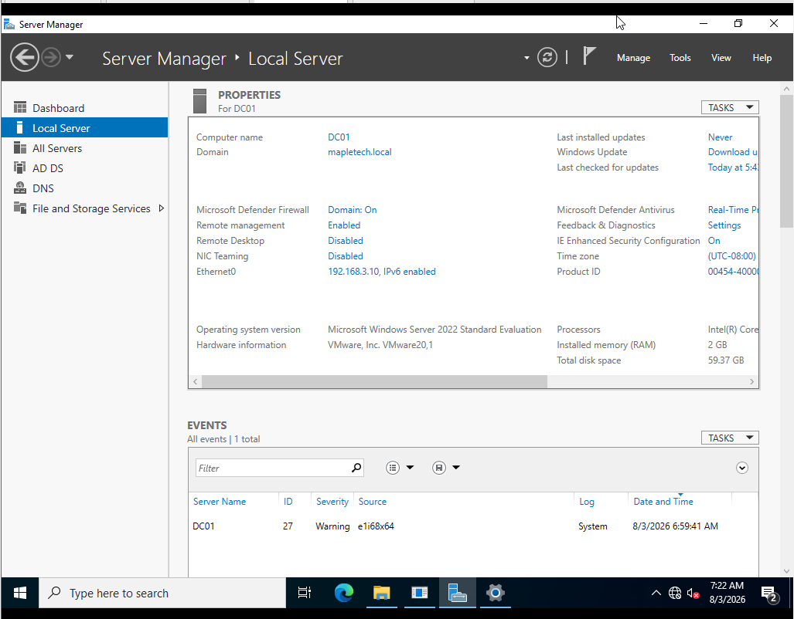
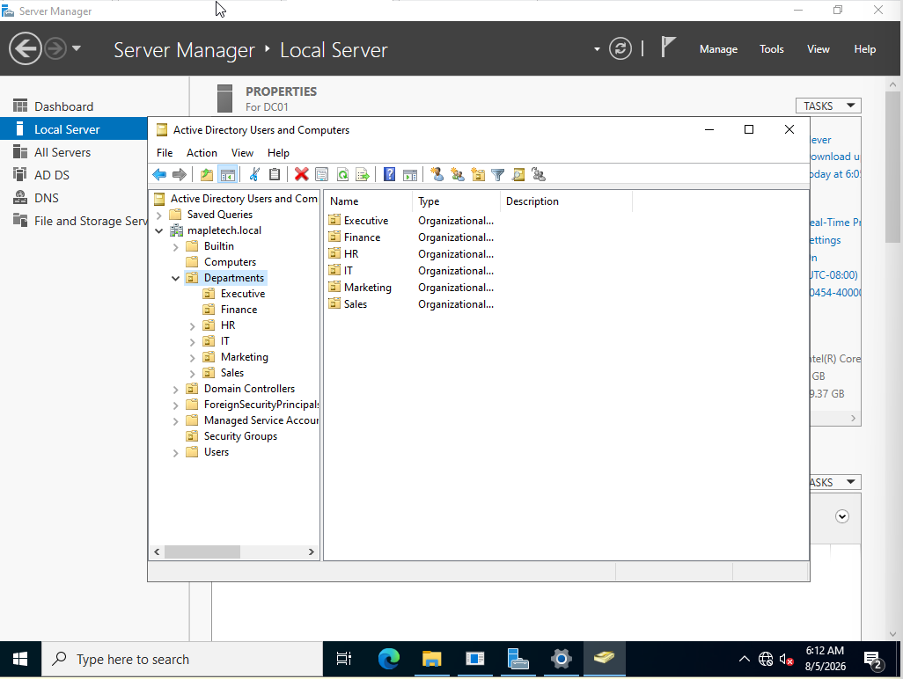
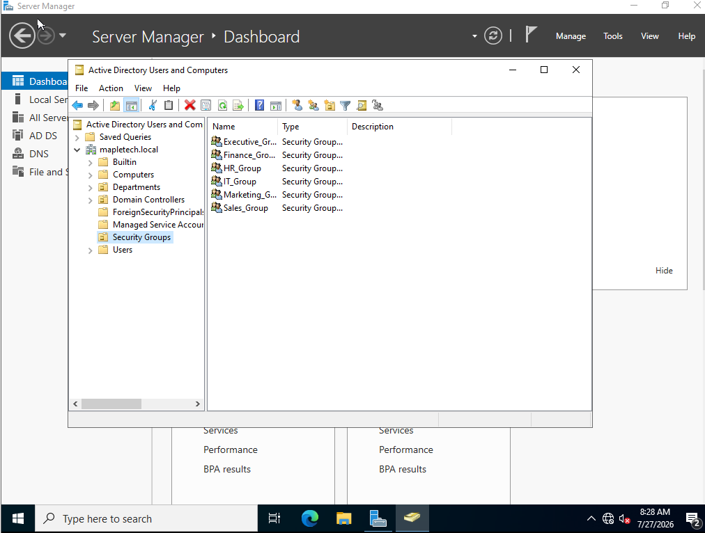
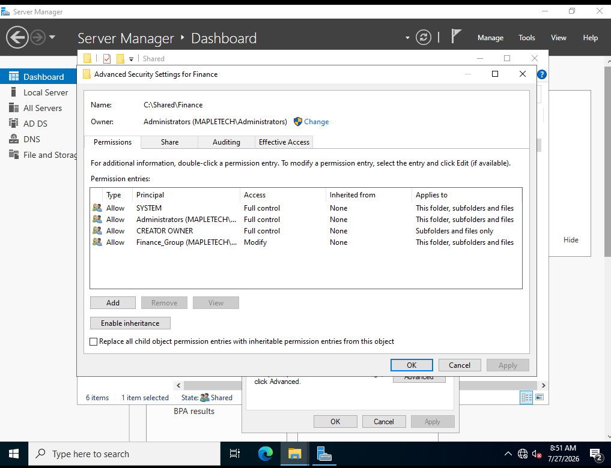
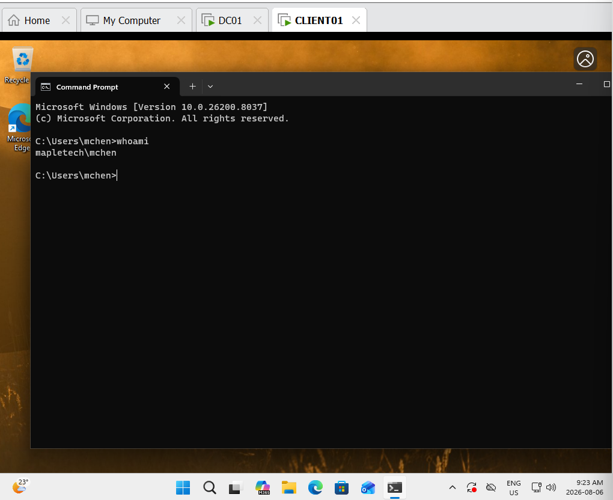
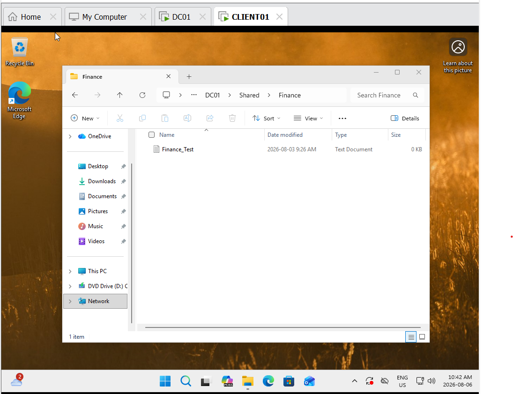
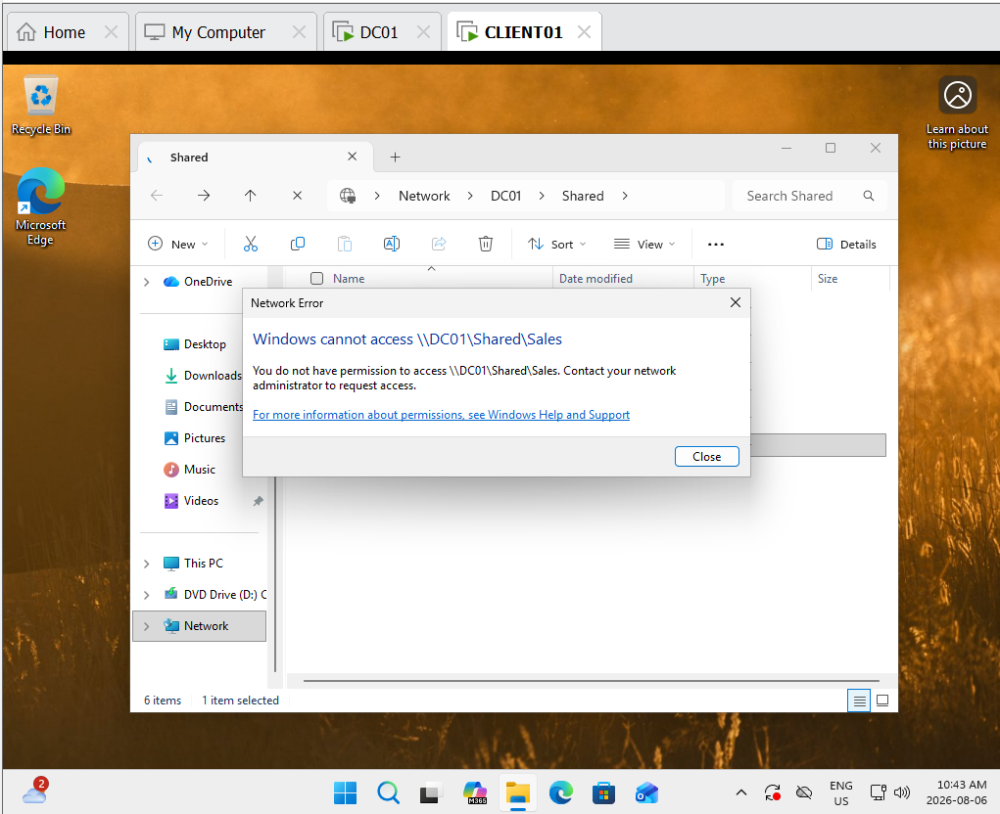

# Active Directory Home Lab

A hands-on Active Directory lab built using Windows Server 2022 and Windows 11 Pro in VMware Workstation Pro.

This project demonstrates the deployment and administration of a small Windows Active Directory environment, including user and group management, Organizational Units, DNS, domain joining, shared folders, and NTFS permissions.

## Lab Environment

- **Hypervisor:** VMware Workstation Pro
- **Domain Controller:** Windows Server 2022
- **Client:** Windows 11 Pro
- **Domain:** `mapletech.local`
- **Domain Controller:** `DC01`
- **Client Computer:** `CLIENT01`

## Project Objectives

The goal of this lab was to build a small Windows-based Active Directory environment and practice common IT administration tasks.

The lab objectives were to:

- Deploy Windows Server 2022 as a Domain Controller.
- Configure Active Directory Domain Services (AD DS) and DNS.
- Create the `mapletech.local` Active Directory domain.
- Organize users using Organizational Units (OUs).
- Create department-based security groups.
- Assign users to the appropriate security groups.
- Configure departmental shared folders.
- Apply NTFS permissions using security groups.
- Join a Windows 11 Pro workstation to the domain.
- Authenticate to the domain using an Active Directory user.
- Test and verify department-based file access.

```markdown
## Active Directory Structure

The domain was organized using Organizational Units (OUs) for each department:

```text
mapletech.local
├── Departments
│   ├── Executive
│   ├── Finance
│   ├── HR
│   ├── IT
│   ├── Marketing
│   └── Sales
│
└── Security Groups
    ├── Executive_Group
    ├── Finance_Group
    ├── HR_Group
    ├── IT_Group
    ├── Marketing_Group
    └── Sales_Group
```

## Server and Active Directory Configuration

Windows Server 2022 was configured as the Domain Controller (DC01) for the `mapletech.local` domain.

The server was configured with a static IPv4 address of `192.168.3.10` and provided Active Directory Domain Services (AD DS) and DNS services for the lab environment.

### Domain Controller Configuration

- **Hostname:** `DC01`
- **Operating System:** Windows Server 2022 Standard Evaluation
- **Domain:** `mapletech.local`
- **IPv4 Address:** `192.168.3.10`
- **Role:** Domain Controller
- **Services:** Active Directory Domain Services (AD DS) and DNS



### Organizational Units

Departmental Organizational Units were created to logically organize users within Active Directory.

The following OUs were created:

- Executive
- Finance
- HR
- IT
- Marketing
- Sales



## Security Groups and User Management

Department-specific security groups were created to simplify permission management.

Users were assigned to their respective departmental security groups rather than receiving permissions individually.

For example, the Finance department uses the `Finance_Group` security group, which contains Finance users such as Michael Chen and Olivia Davis.




## Shared Folders and NTFS Permissions

A shared folder structure was created on DC01 to separate departmental resources:

```text
C:\Shared
├── Executive
├── Finance
├── HR
├── IT
├── Marketing
└── Sales
```

NTFS permissions were configured so that each department's security group could access its corresponding folder.

For example, `Finance_Group` was granted **Modify** permissions to the Finance folder, while Administrators and SYSTEM retained Full Control.



## Windows 11 Client and Domain Authentication

A Windows 11 Pro workstation named `CLIENT01` was configured and joined to the `mapletech.local` Active Directory domain.

The client was configured with:

- **Computer Name:** `CLIENT01`
- **Domain:** `mapletech.local`
- **Operating System:** Windows 11 Pro
- **DNS Server:** `192.168.3.10` (DC01)



## Permission Testing

The Active Directory configuration and NTFS permissions were tested using the Finance domain user `mchen`.

The tests confirmed that:

- The Finance user could access the Finance shared folder.
- The Finance user could create a file within the Finance folder.
- The Finance user was denied access to the Sales folder.

### Successful Access



### Denied Access



## Results

The lab successfully demonstrated:

- Windows Server 2022 configured as an Active Directory Domain Controller.
- Active Directory Domain Services and DNS configuration.
- Organizational Unit and security group management.
- Department-based user organization.
- Group-based NTFS permissions.
- Windows 11 Pro domain joining.
- Domain user authentication.
- Successful and restricted access to departmental resources.

This lab provided hands-on experience with common Windows administration and IT support tasks in a controlled virtual environment.
